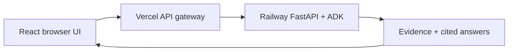

# RFP Frontend — Bidwell

**[Open the live demo](https://rfp-frontend-roan.vercel.app/)**

**OPEN LIVE DEMO (Deployed):** [https://rfp-frontend-roan.vercel.app/](https://rfp-frontend-roan.vercel.app/)

Demo login: `admin@gmail.com` / `admin` · By [Zaheer](https://github.com/zaheer037).

https://github.com/user-attachments/assets/5bf67e6d-3ad5-4c04-986f-ac087b69bea7

[Browser video player](https://rfp-frontend-roan.vercel.app/demo.html) · [Google Drive fallback](https://drive.google.com/file/d/1gLtL16zGsFf8m7f_c9N-Hp1YCBAFMel1/view) · [Backend repository](https://github.com/zaheer037/rfp-intelligence-) · [Full demo download](https://github.com/zaheer037/rfp-intelligence-/blob/main/demo/Bidwell_Demo_with_voiceover.mp4)

A React workspace for **cited chat, bid research, extraction and comparison**.

## Verified results

| Check | Result | Scope |
| --- | --- | --- |
| UI and session checks | **19 / 19 passed** | Hosted Vercel |
| Real-data user workflows | **15 / 15 passed** | Hosted Vercel + Railway |
| Unit / integration tests | **14 passed** | Local / GitHub CI |
| Browser JavaScript errors | **0** | Hosted checks |
| Responsive widths | **320–1440 px** | Hosted checks |
| Lighthouse mobile | **90 performance · 100 accessibility · 100 best practices · 100 SEO** | Local snapshot |

[Hosted QA](artifacts/production-qa.json) · [Unit tests](artifacts/repository-tests.txt) · [Lighthouse report](artifacts/lighthouse-mobile.json)

## Architecture



Backend keys stay in the **server-side gateway**. The browser uses signed HttpOnly session cookies.

## Workspace

| Feature | What you can do |
| --- | --- |
| Chat | Ask questions with citations and live agent activity |
| Bid library | Upload/index documents, view 20-field records, export JSON |
| Search | Filter evidence by bid, document type and addendum |
| Compare | View cited answers and requirements side by side |
| Runs and quality | Inspect traces, validation, retrieval scores and usage |

## Run locally

Use **Node 22** and a running backend.

```bash
git clone https://github.com/zaheer037/rfp-frontend.git
cd rfp-frontend
npm ci
cp .env.example .env
# Set BACKEND_URL, BACKEND_API_KEY and SESSION_SECRET.
npm run dev
```

Open `http://localhost:5173`. Set `VITE_SITE_URL` to the deployed frontend origin for public metadata.

## Deploy and develop

[Vercel setup](VERCEL.md) · [Development guide](docs/DEVELOPMENT.md) · [QA details](QA_REPORT.md) · [Backend repository](https://github.com/zaheer037/rfp-intelligence-)

```bash
npm run lint
npm test
npm run build
```
