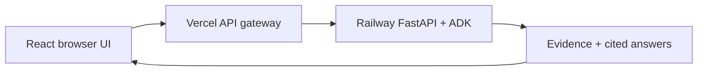

# RFP Frontend — Bidwell

**[Open the live demo](https://rfp-frontend-roan.vercel.app/)**

**OPEN LIVE DEMO (Deployed):** [https://rfp-frontend-roan.vercel.app/](https://rfp-frontend-roan.vercel.app/)

Demo login: `admin@gmail.com` / `admin` · By [Zaheer](https://github.com/zaheer037).

https://github.com/user-attachments/assets/5bf67e6d-3ad5-4c04-986f-ac087b69bea7

[Browser video player](https://rfp-frontend-roan.vercel.app/demo.html) · [Google Drive fallback](https://drive.google.com/file/d/1gLtL16zGsFf8m7f_c9N-Hp1YCBAFMel1/view) · [Backend repository](https://github.com/zaheer037/rfp-intelligence-) · [Full demo download](https://github.com/zaheer037/rfp-intelligence-/blob/main/demo/Bidwell_Demo_with_voiceover.mp4)

A React workspace for **cited chat, bid research, extraction and comparison**.

## Verified results

| Check | Result | Scope |
| --- | --- | --- |
| UI and session checks | **19 / 19 passed** | Hosted Vercel |
| Real-data user workflows | **15 / 15 passed** | Hosted Vercel + Railway |
| Unit / integration tests | **14 passed** | Local / GitHub CI |
| Browser JavaScript errors | **0** | Hosted checks |
| Responsive widths | **320–1440 px** | Hosted checks |
| Lighthouse mobile | **90 performance · 100 accessibility · 100 best practices · 100 SEO** | Local snapshot |

[Hosted QA](artifacts/production-qa.json) · [Unit tests](artifacts/repository-tests.txt) · [Lighthouse report](artifacts/lighthouse-mobile.json)

## Architecture



Backend keys stay in the **server-side gateway**. The browser uses signed HttpOnly session cookies.

## Workspace

| Feature | What you can do |
| --- | --- |
| Chat | Ask questions with citations and live agent activity |
| Bid library | Upload/index documents, view 20-field records, export JSON |
| Search | Filter evidence by bid, document type and addendum |
| Compare | View cited answers and requirements side by side |
| Runs and quality | Inspect traces, validation, retrieval scores and usage |

## Run locally

Use **Node 22** and a running backend.

```bash
git clone https://github.com/zaheer037/rfp-frontend.git
cd rfp-frontend
npm ci
cp .env.example .env
# Set BACKEND_URL, BACKEND_API_KEY and SESSION_SECRET.
npm run dev
```

Open `http://localhost:5173`. Set `VITE_SITE_URL` to the deployed frontend origin for public metadata.

## Deploy and develop

[Vercel setup](VERCEL.md) · [Development guide](docs/DEVELOPMENT.md) · [QA details](QA_REPORT.md) · [Backend repository](https://github.com/zaheer037/rfp-intelligence-)

```bash
npm run lint
npm test
npm run build
```

Shared demo workspace; extraction confidence is a heuristic. The recorded hosted QA includes a partial Bid2 extraction and configuration findings—see the linked report.

## Full documentation

A standalone React frontend for `rfp-intelligence`. This standalone repository deploys to Vercel; the FastAPI backend deploys separately to Railway. The browser uses same-origin `/api` requests; a Vercel Node function forwards them with a server-side backend API key.

## Run locally (full details)

Use Node 22 (pinned by `package.json`). Start the backend on port 8000 with its own `.env` and indexed Bid1/Bid2 collections, then:

```bash
git clone https://github.com/zaheer037/rfp-frontend.git
cd rfp-frontend
npm ci
cp .env.example .env
# Set BACKEND_API_KEY to the backend RFP_API_KEY.
# Set SESSION_SECRET to a random secret of at least 32 characters.
npm run dev
```

Open http://localhost:5173. The local API service runs on port 3001; Vite forwards `/api` to it. Demo login: **admin@gmail.com / admin**. Login opens the chatbot first. Its live activity panel distinguishes the seven configured agent roles from the number of steps currently executing; zero means idle. The extraction role includes three parallel specialists.

For the optimized build on local HTTP:

```bash
VITE_SITE_URL=http://localhost:4173 npm run build
SERVE_DIST=1 WEB_PORT=4173 npx tsx server/local.ts
```

The public demo shares documents and run history between demo sessions. The login is intentionally public, with no tenant isolation. Use public sample documents. For a private product, replace this demo authentication with individual accounts and authorization before onboarding customers.

## Features and responsibilities

| Location | Responsibility |
| --- | --- |
| `src/pages/Landing.tsx` | Landing page, document examples, responsive GSAP motion |
| `src/pages/Login.tsx` | Demo sign-in and actionable errors |
| `src/pages/Workspace.tsx` | Protected navigation and mobile workspace shell |
| `src/pages/workspace/Library.tsx` | Bid collections, upload/index jobs, rebuild from backend folder |
| `src/pages/workspace/BidDetail.tsx` | Documents, all 20 fields, validation, addendum changes, JSON export |
| `src/pages/workspace/Search.tsx` | Dense/hybrid/reranked evidence search and metadata filters |
| `src/pages/workspace/Questions.tsx` | Cited Q&A, cross-bid questions and 20-field comparison |
| `src/pages/workspace/Runs.tsx` | Persistent job status, agent trace and token usage |
| `src/pages/workspace/Insights.tsx` | Actual retrieval evaluation and process metrics |
| `src/components/AgentActivity.tsx` | Live running-step count and the seven role descriptions |
| `src/components/Common.tsx`, `Sources.tsx` | Shared states and the separately bundled evidence viewer |
| `src/lib/api.ts` | Typed requests, bounded job polling, expired-session redirect |
| `server/handler.ts` | Shared local/Vercel API boundary; allowlisted backend proxy |
| `server/security.ts` | Signed session cookies, origin checks, bounded rate limiter |
| `scripts/metadata.ts` | Canonical/social metadata, robots/sitemap and CSP hash |

Radix Themes supplies product controls and accessible interactions. Satoshi is self-hosted. Light/dark themes respect system preference and persist only the theme in local storage. Reduced-motion preference disables decorative animation.

Uploads accept PDF, HTML and images: at most 20 files and 2 MB total per collection through the demo UI. Larger existing collections can be placed in the backend input directory and indexed through the folder option. Jobs run asynchronously and persist in the backend; closing the page does not cancel an accepted job. Missing evidence is shown explicitly, and confidence is a heuristic rather than a calibrated probability.

## Deploy to Vercel

Import **`zaheer037/rfp-frontend`** into Vercel. Set **Root Directory** to the repository root (`./`), framework **Vite**, install command **`npm ci`**, build command **`npm run build`**, output directory **`dist`**, and Node.js **22.x**. The supplied `vercel.json` configures the `/api` function and React deep links. See [VERCEL.md](VERCEL.md) for the complete Railway connection and smoke checks. Configure these environment variables before deploying:

| Variable | Value |
| --- | --- |
| `BACKEND_URL` | Railway public HTTPS backend URL, e.g. `https://your-backend.up.railway.app` (no `/api` suffix) |
| `BACKEND_API_KEY` | Exact backend `RFP_API_KEY` |
| `SESSION_SECRET` | Random secret, at least 32 characters |
| `DEMO_EMAIL` | `admin@gmail.com` |
| `DEMO_PASSWORD` | `admin` |
| `VITE_SITE_URL` | Canonical public Vercel/custom domain URL, without trailing slash |

Only `VITE_SITE_URL` is public. Never prefix a key or session secret with `VITE_`. The Groq key belongs exclusively to the backend. All browser requests use same-origin `/api`; Vercel's function attaches the backend key. Session cookies are HttpOnly, SameSite=Lax, signed, expire after eight hours and use Secure in production. Logout clears the current browser cookie; global token revocation is not implemented for the shared demo.

Builds generate metadata and a CSP hash. Rebuild after changing the canonical domain. Vercel functions handle short requests and job polling, while extraction remains in the backend. Keep the backend's persistent disk and one-worker limits from its deployment instructions. The frontend does not require browser-to-Railway CORS access.

Before exposing a public paid Groq-backed demo, configure Vercel Firewall rate limits or another shared rate store. The included bounded in-process limiter protects one function instance and does not enforce a global quota across serverless instances. Use backend admission limits and provider spending limits as well.

## Verification

```bash
npm run lint
npm test
npm run build
npx playwright install chromium
QA_URL=http://localhost:4173 npm run test:e2e
```

The user journey test requires the running frontend, connected backend, real Groq credentials and extracted Bid1/Bid2 records. It uses a visible browser by default (`CI=true` enables headless); `CHROME_PATH=/usr/bin/google-chrome` selects an installed Chrome. It exercises live model requests and creates one small `BrowserQA-*` collection; the exact identifier is saved in `artifacts/qa-upload-id.txt` for intentional cleanup. Run it against a test workspace. The evaluation, traces and screenshots are actual outputs, not hardcoded UI fixtures.

Unit coverage is deliberately scoped to session/security and formatting helpers. Browser tests cover user workflows. See `QA_REPORT.md` for measured results and remaining deployment checks. Neither Vercel nor Railway has been deployed by this repository-publishing task.

The chatbot shows independent cited Q&A results and visible message history; it does not add server-side multi-turn conversation memory.
